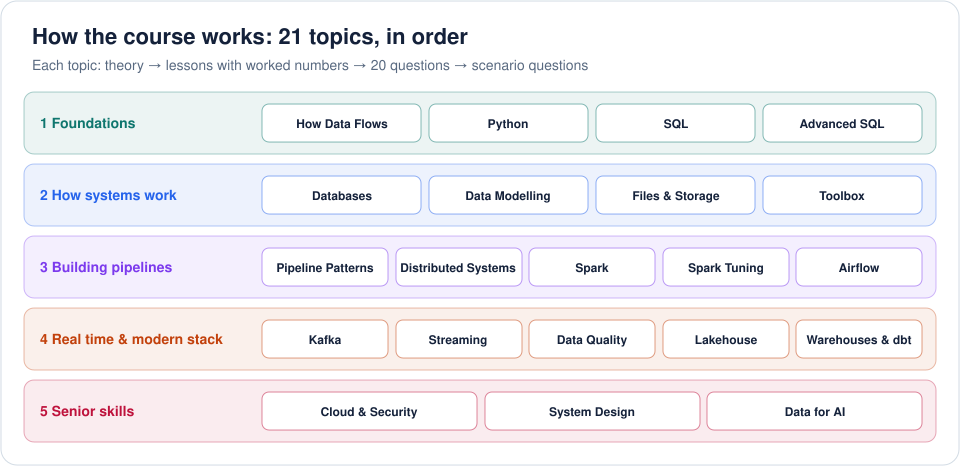
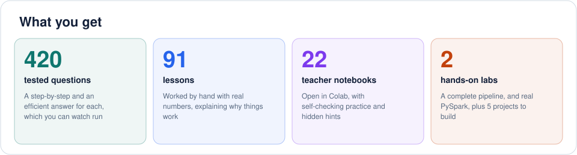

# Data Engineering: From Scratch to Advanced

A complete course for becoming a strong data engineer, with no experience needed. It starts at "what is a pipeline?" and goes to designing whole data platforms. Every idea is worked with real numbers, and every answer is tested before publishing.

**[Open the course](https://abpandey-dev.github.io/data-engineering-from-scratch-to-advanced/course/)** · **[SQL IDE](https://abpandey-dev.github.io/data-engineering-from-scratch-to-advanced/ide/sql.html)** · **[Start Here notebook](notebooks/00_START_HERE.ipynb)** · **[All notebooks](notebooks/README.md)** · **[Labs](labs/README.md)**





## Three ways to learn

| Way | Best for | What's there |
|---|---|---|
| [**Website**](https://abpandey-dev.github.io/data-engineering-from-scratch-to-advanced/course/) | visual learning | theory, lessons, and watching answers run line by line, in the browser |
| [**SQL IDE**](https://abpandey-dev.github.io/data-engineering-from-scratch-to-advanced/ide/sql.html) | practising SQL | real SQL in your browser on 4 sample databases, with 43 questions that check your answer |
| [**Notebooks**](notebooks/README.md) | working through it, teacher-style | self-checking practice, hidden hints and answers. Open in Colab with nothing to install |
| [**Labs**](labs/README.md) | building | a complete pipeline, real PySpark, and 5 projects to build yourself |

## All the question types

- **Coding:** Python and real SQL on a real database, each with a step-by-step and an efficient answer.
- **Concept:** short interview answers to practise out loud.
- **Scenario and debugging:** "revenue doubled", "the job's stuck at 99%", "the bill spiked".
- **System design:** sizing, trade-offs and full walkthroughs.

## The topics

| # | Topic | What it covers |
|---|---|---|
| 1 | [How Data Flows](notebooks/topics/01_big-picture.ipynb) | What a data engineer actually does: the data lifecycle, ETL vs ELT, OLTP vs OLAP, batch vs streaming, and how to think about volume, freshness and reliability. No experience needed. |
| 2 | [Python for Pipelines](notebooks/topics/02_python-for-de.ipynb) | The Python a data engineer uses every day: dates and time zones, processing files too big for memory with generators, batching, retries, validation, logging and writing code you can test. |
| 3 | [SQL Foundations](notebooks/topics/03_sql-foundations.ipynb) | The most important skill in data engineering, from your very first query: SELECT, WHERE, sorting, aggregates, GROUP BY, HAVING, all the joins, NULLs, CASE and subqueries, on a real database. |
| 4 | [Advanced SQL](notebooks/topics/04_sql-advanced.ipynb) | The SQL that separates beginners from professionals: CTEs, every window function, top-N per group, running totals, sessionisation, gaps and islands, deduplication, retention, funnels and recursive queries. |
| 5 | [How Databases Work](notebooks/topics/05_database-internals.ipynb) | What's inside a database: pages, B-trees and indexes, query plans and join algorithms, transactions and isolation levels, write-ahead logs, locks, MVCC and LSM trees. You'll build each one in miniature. |
| 6 | [Data Modelling](notebooks/topics/06_data-modeling.ipynb) | How to design tables people can trust: grain, keys, normalisation, star schemas, facts and dimensions, slowly changing dimensions, snapshots and surrogate keys. This is what separates senior engineers. |
| 7 | [Files, Formats & Storage](notebooks/topics/07_storage-formats.ipynb) | How data is laid out on disk and why it decides your speed and bill: CSV vs JSON vs Parquet, columnar storage, compression, run-length and dictionary encoding, partitioning, the small-file problem and object storage. |
| 8 | [Engineering Toolbox](notebooks/topics/08_engineering-toolbox.ipynb) | The everyday skills around the data: Linux commands, Git, Docker, cron, testing, CI/CD and environments. Each idea is modelled in Python, so you understand what the tools are really doing. |
| 9 | [Pipeline Patterns](notebooks/topics/09_pipeline-patterns.ipynb) | The heart of the job: idempotent loads, incremental processing, watermarks, merge and upsert, change data capture, backfills, late data, deduplication, dead-letter queues and designing for failure. |
| 10 | [Distributed Systems](notebooks/topics/10_distributed-systems.ipynb) | Why big data tools work the way they do: partitioning, MapReduce, replication, quorums, consistent hashing, CAP, failures, Amdahl's law and exactly-once. Understand this and Spark and Kafka make sense. |
| 11 | [Spark Foundations](notebooks/topics/11_spark-foundations.ipynb) | Apache Spark from zero: the driver and executors, lazy evaluation, transformations vs actions, narrow vs wide, DataFrames and PySpark's API. You build a tiny Spark in plain Python to see how it works, then run the real thing in the labs. |
| 12 | [Spark Tuning & Internals](notebooks/topics/12_spark-internals.ipynb) | Make Spark fast and stop it crashing: join strategies, broadcast, skew and salting, shuffle tuning, adaptive execution, memory, out-of-memory errors, file sizes, reading the Spark UI, and real debugging. |
| 13 | [Orchestration With Airflow](notebooks/topics/13_airflow.ipynb) | Running pipelines reliably: DAGs and topological order, schedules and data intervals, catchup and backfills, retries, sensors, XComs, pools and common mistakes. You'll build a tiny scheduler to see how it works. |
| 14 | [Kafka & Messaging](notebooks/topics/14_kafka.ipynb) | The backbone of streaming: logs, topics and partitions, keys and ordering, consumer groups, offsets and lag, delivery guarantees, replication, retention and compaction, schemas. You'll build a tiny Kafka in Python. |
| 15 | [Stream Processing](notebooks/topics/15_streaming.ipynb) | Processing data that never ends: event time vs processing time, tumbling, sliding and session windows, watermarks and late data, stateful processing, stream joins, checkpoints and exactly-once, with Spark and Flink in mind. |
| 16 | [Data Quality & Observability](notebooks/topics/16_data-quality.ipynb) | Trustworthy data: the dimensions of quality, tests for nulls, uniqueness, ranges and freshness, anomaly detection, reconciliation, data contracts, lineage and running incidents. This is where a QA background becomes a superpower. |
| 17 | [Lakehouse & Table Formats](notebooks/topics/17_lakehouse.ipynb) | Database features on cheap files: why plain lakes break, how Iceberg and Delta use snapshots and manifests, ACID on object storage, time travel, MERGE, copy-on-write vs merge-on-read, compaction and clustering. |
| 18 | [Warehouses & dbt](notebooks/topics/18_warehouses-dbt.ipynb) | Modern analytics engineering: how cloud warehouses store and bill, clustering and distribution keys, views vs tables vs materialized views, and dbt's models, tests, incremental loads and snapshots. You'll build a tiny dbt. |
| 19 | [Cloud, Cost & Security](notebooks/topics/19_cloud-security.ipynb) | Running data platforms on AWS responsibly: S3, Glue, EMR, Athena and Redshift, IAM permissions, encryption, masking and pseudonymising personal data, access control, privacy law, reliability targets and controlling the bill. |
| 20 | [Data System Design](notebooks/topics/20_system-design.ipynb) | How senior engineers think: a repeatable design framework, sizing, choosing tools and walkthroughs of clickstream analytics, CDC to a lake, real-time dashboards and data platforms, with the trade-offs interviewers want to hear. |
| 21 | [Data Engineering for AI](notebooks/topics/21_data-for-ai.ipynb) | The data behind models and LLMs: feature stores and point-in-time joins, leakage, dataset versioning, RAG ingestion pipelines, incremental embedding, deduplication, PII scrubbing and evaluation data. It's a bridge from data engineering to AI engineering. |

## The SQL IDE

Write SQL and run it on real SQLite in your browser, with nothing to install and nothing you can break.

- **Sample databases:** browse tables and columns, preview rows, and reset any changes.
- **Practice:** 43 questions check your result against the expected answer, with hints, expected output, model answers and saved progress.
- **Help when it fails:** error messages come with plain-English hints, and wrong answers tell you what looks off, such as too many rows or the wrong order.
- **Editor:** highlighting, completion with Ctrl + Space, and running just the selected text.

Practice data is built from the course's tested questions by `scripts/build_sql_practice.py`.

## What's real, and what's a simulation

Spark, Kafka and Airflow can't run in a browser, so practice questions model how they work in plain Python, which also makes the mechanics easy to see. That means:

- **Tested for real:** every question's answers, all lesson demos, SQL on SQLite, the notebooks, and [the PySpark lab](labs/spark_lab.py) on Spark 4.3.
- **Shown as text and not run here:** Airflow, Kafka, dbt, Structured Streaming and AWS snippets, as they need running services. Check them against current documentation before relying on them.
- **Prices in the questions are made up,** for practising the sums.

No course can make someone top 2% by itself. That also takes building real systems and fixing them when they break. This course gives you the understanding and the practice; [the labs](labs/README.md) get you started on the rest.

## Run it locally

```bash
python3 -m http.server 8000      # then open http://localhost:8000/course/
```

To rebuild after changing content (this needs numpy, pandas and matplotlib):

```bash
python3 engine/build.py --book course
python3 scripts/build_sql_practice.py
python3 notebooks/build_notebooks.py
python3 notebooks/verify_notebooks.py answers
```
